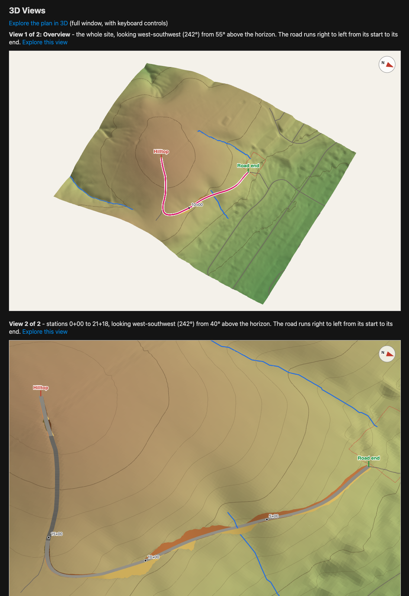

# Roadie

Roadie engineers low-volume roads (driveways, rural access roads, and forest roads) on USGS lidar
terrain, and views the resulting road grading plans in 3D.

- **`make run`** runs the Roadie application, in your web browser. Open a plan, or make a new one -
  its config is the road's start and end points (their latitudes and longitudes) and its planning
  notes. Run the plan to engineer its road options - the planning tools build the site from the USGS
  3D Elevation Program's 1 meter lidar terrain and engineer the roads, and an
  [Ollama](https://ollama.com) model answers what its notes ask - then view them, edit the config and
  run it again, and save the plan to a file. See [The Roadie application](#the-roadie-application).
- **`make plan FILE=<site.json> OUTPUT=<plan.json>`** launches a Claude Code session with detailed
  road engineering instructions ([PLAN.md](plan/PLAN.md)). The road site model (`FILE`, a JSON file)
  has the road's start and end points - their latitudes and longitudes - and its planning notes.
  Claude builds the site from the USGS 3D Elevation Program's 1 meter lidar terrain, engineers one or
  more cost-optimal road plan options from the start point to the end point, and writes the road plan
  model (`OUTPUT`, another JSON file).
- **`make update FILE=<plan.json>`** launches a Claude Code session that
  updates an existing road plan model with review feedback (from the city or county, a surveyor, or
  the owner, for example).
- **`make auto FILE=<site.json> OUTPUT=<plan.json> [OLLAMA_MODEL=<model>]`** plans a road by
  procedure from the command line - what the application's "Run" does. The planning tools do every
  step, and an Ollama model (a local model, or one of Ollama's cloud models) is asked only what the
  site's notes ask for.



Roadie has three parts: the **viewer** ([viewer/](viewer/)) and the **planning tools and
instructions** (`plan/`) - both JavaScript - and the **application** (`app/`), a Python package whose
command line serves the viewer, with the planning tools. It requires `make` and Node.js 22 or later -
Python 3.11 or later for the application - and [Claude Code](https://claude.com/claude-code) to plan
and update roads (see [Installing](#installing)).
A site must be in the United States, where the USGS has 1 meter lidar terrain.


## Installing

Roadie runs from a clone of its repository, on macOS, Linux, and Windows. It needs:

- `make`, `git`, and `curl` (or `wget`)
- [Node.js](https://nodejs.org/en/download) 22 or later
- [Python](https://www.python.org/downloads/) 3.11 or later, for the application (`make run`)
- [Claude Code](https://code.claude.com/docs/en/setup), to plan and update roads - viewing a plan
  doesn't need it

The first `make` command downloads the build's files and npm packages, so it takes a minute.


### macOS

1. Install the Xcode Command Line Tools - they have `make` and `git`:

   ```
   xcode-select --install
   ```

2. Install [Node.js](https://nodejs.org/en/download) - its installer, or `brew install node` with
   [Homebrew](https://brew.sh).
3. Install Claude Code:

   ```
   curl -fsSL https://claude.ai/install.sh | bash
   ```

4. Clone Roadie:

   ```
   git clone https://github.com/craigahobbs/roadie.git
   ```


### Linux

1. Install `make`, `git`, and `curl` with your distribution's package manager - for example,
   `sudo apt install make git curl` (Debian and Ubuntu) or `sudo dnf install make git curl` (Fedora).
2. Install [Node.js](https://nodejs.org/en/download) 22 or later. A distribution's own Node.js package
   may be older - check it with `node --version`.
3. Install Claude Code:

   ```
   curl -fsSL https://claude.ai/install.sh | bash
   ```

4. Clone Roadie:

   ```
   git clone https://github.com/craigahobbs/roadie.git
   ```

`make run` opens the application in your web browser - if it can't (on a server, or in the Windows
Subsystem for Linux), open the URL that `make run` prints.


### Windows

Roadie's `make` commands need a Unix shell. On Windows, that's [MSYS2](https://www.msys2.org/) - run
every Roadie command in its terminal.

1. Install [MSYS2](https://www.msys2.org/), in its default folder (`C:\msys64`).
2. Install [Node.js](https://nodejs.org/en/download) with its Windows installer.
3. Install Claude Code - in PowerShell:

   ```
   irm https://claude.ai/install.ps1 | iex
   ```

   If the installer's setup notes say that its folder isn't in your `PATH`, add it as they describe.
4. Let the MSYS2 terminal find Windows programs (`node` and `claude`) - MSYS2 hides them unless this
   Windows environment variable is set. In PowerShell:

   ```
   setx MSYS2_PATH_TYPE inherit
   ```

5. Open a new "MSYS2 UCRT64" terminal from the Start menu, and install `make` and `git` - MSYS2 doesn't
   come with them:

   ```
   pacman -S --needed make git
   ```

6. Have Claude Code run its commands with the MSYS2 shell, where `make` is - add its setting to the
   terminal's startup file, and open a new terminal:

   ```
   echo "export CLAUDE_CODE_GIT_BASH_PATH='C:\msys64\usr\bin\bash.exe'" >> ~/.bashrc
   ```

7. Clone Roadie:

   ```
   git clone https://github.com/craigahobbs/roadie.git
   ```

The MSYS2 terminal starts in its own home folder, `C:\msys64\home\<your name>`. Your Windows folders
are under `/c/` there - `cd /c/Users/<your name>/Documents`, for example.


### Checking the installation

In a new terminal, each of these prints a version:

```
make --version
node --version
claude --version
```

Then run Roadie - it opens in your web browser (Ctrl-C stops it):

```
cd roadie
make run
```

Open the example plan, `example/example.json`, with "Open Plan", and view it with "View Plan".


### Your first road

1. Make a folder for the road's files, beside the `roadie` folder - not in it:

   ```
   mkdir driveway
   ```

2. Create the road site model in it - a JSON text file, `driveway/site.json`, with the road's start and
   end points (see [Planning a road](#planning-a-road) for its contents).
3. Plan the road, from the `roadie` folder - `OUTPUT` is the road plan model to write:

   ```
   cd roadie
   make plan FILE=../driveway/site.json OUTPUT=../driveway/driveway.json
   ```

   Claude Code asks you to log in the first time it runs. Log in with your Claude subscription (the
   free plan doesn't include Claude Code) - not with API billing, which charges for each token the
   planning session uses. The session takes a while, and writes the road plan model,
   `driveway/driveway.json`.
4. View the plan when the session finishes - `make run`, and open `driveway/driveway.json`.

Or skip the session: `make run`, make a new plan with the road's start and end points, and run it.


## The Roadie application

`make run` runs the application, and opens it in your web browser (`Ctrl-C` stops it). Its home page:

- **Open Plan** - choose or drop a plan's JSON file (and its source map image, to show it in the
  report). The files stay on your computer - they're kept in the browser's storage, and the home
  page lists the recent files (remove one with its ✕).
- **New Plan** - a form for the plan's config: its title, units, start and end points, notes, design
  criteria, cost rates, and its site's margin and grid spacing. An empty member is its default - its
  box shows it. To set a point, copy its latitude and longitude from a map (Google Maps, say) and
  paste them into its latitude.

A plan is its config and, once it's run, its **road options**. The opened or new plan is the
**loaded plan** - the home page shows its config (its points, the distance between them, its notes
and criteria), and what can be done with it:

- **View Plan** - its road options' report (each option's length, maximum grade, earthwork, walls,
  warnings, and cost score, its plan and profile, and its 3D views), and the 3D explorer.
- **Edit Plan** - its config: the notes, say. If the plan has road options, they're from the config
  before - run the plan to engineer them again.
- **Run Plan** - choose an Ollama model to read its notes (or none - the last model chosen is the
  default). The planning tools run in the page: the run's steps are shown as it goes, with its time,
  and its result and report when it's done. **Stop** stops it, when its current step's work is done -
  and its work is thrown away. The road options it engineers are
  the plan's - a plan that's run again keeps its other options and features. **Clear Road Options**
  clears them: the plan is its config again.
- **Save** the plan to its file - the file it was opened from, or saved to - or **Save As** another,
  to duplicate it (and run it with another config, say). A plan with road options keeps its config
  and its map image, so it's one file - and a plan without road options is its config's file.
- **Close** it - if it has changes that aren't saved, you're asked first.

Ollama answers the application's page when it runs on this computer (`http://127.0.0.1:11434`).


## The viewer

The viewer's report - meant to be read and printed - computes each option's earthwork, structures,
and cost score, then shows:

- **Plan options** - a comparison of every option's length, maximum grade, cut, fill, net import or
  export, retaining walls, design warnings, and cost score (select an option to view it)
- **Plan view** - a contour map with the road footprint (cut and fill slopes), structures, station
  ticks, the other options' centerlines, and the outlines of the 3D views. Click it to explore the 3D
  landscape from that point.
- **Profile** - the ground and road grade along the road, with cut and fill areas, structures, and
  grades over the maximum highlighted
- **3D views** - the terrain (with contours) graded to the road's finished surface: the road, cut and
  fill slopes, retaining walls, bridges, culverts, streams, station labels, and other features. The
  first view is always the whole site. When the road is too narrow to see in it, views of equal road
  segments follow, from the start to the end. Every view keeps the overview's general orientation, so
  the reader stays oriented across the views. Each looks across its road segment - preferably upslope,
  where the road's cuts into the hillsides and its fill slopes face the viewer - at the lowest tilt
  that shows all of its road (from straight above, if the terrain hides parts of it at every tilt).
- **Cost** - the cost breakdown by item
- **Design warnings** - grades over the maximum, curves under the minimum radius, slopes that don't
  daylight (retaining walls needed), walls over the maximum height, unprotected stream crossings,
  exclusion areas, and ends that miss the start/end points or don't tie in to the ground
- **Structures** and the **source map** image

The 3D views are drawn from the plan's full elevation grid, as detailed as the computer can draw
quickly. Where a view is zoomed in far enough for the grid's cells to show, the terrain is smoothed -
each grid cell is divided into smaller cells interpolated between the grid points, clamped to each
grid cell's corner elevations. Smooth terrain looks smoother up close but is no more accurate.

On large sites, where the road is too narrow to see at a view's scale, the selected option's road is
also drawn as a highlighted centerline.

The report's "Explore" links open the full-window **3D explorer**, controlled with the keyboard:

| Keys | Action |
| --- | --- |
| Arrows or W A S D | Move left, right, forward, and back |
| + / - | Zoom in and out |
| Q / E or Shift+Left / Right | Rotate |
| Shift+Up / Down | Tilt - view more from above or from the side |
| R / F or Page Up / Down | Raise and lower the view |
| [ / ] | Less and more vertical exaggeration |
| T, N, 0 | Top view, face north, and reset |
| H | Show or hide the keyboard help |
| Esc | Back to the report |


### Viewing a road plan

The application views a road plan that's opened, or made by a run. The viewer is also a web site (see [Publishing](#publishing)) that views plans without installing
anything:

- **Open a local plan** - on the viewer's home page, select or drop the plan's JSON file (and its
  source map image, to show it in the report). Local files stay on your computer - they're kept in
  the browser's storage, so the plan's URL works after a reload, and the home page lists the recent
  plans.
- **View a plan URL** - `viewer/#url=<plan.json URL>` (the URL is relative to the viewer). The plan's
  map image is relative to the plan's URL. Plans hosted on another site must allow cross-origin
  requests (CORS).
- **View the example** - the web site's viewer has a link to [the example](#the-example) on its home
  page.

The viewer validates every plan it loads against the [road plan model](#the-road-plan-model), and
reports the first problem it finds.


## The cost score

The cost score is the estimated construction cost in thousands of nominal US dollars - for comparing
plan options, not as a bid estimate. Roadie computes it from typical 2023-2025 unit rates (state DOT
average bid prices and low-volume road references):

- **Earthwork** by the average end area method. Cross sections every third of a grid cell model the
  road template, cut slopes (1:1 soil, 0.5:1 rock), and fill slopes (1.5:1) against the ground's
  cross slope. Rock excavation applies within rock outcrop areas.
- **Mass balance** - shrinkage and swell, borrow (import), waste (export), and overhaul from the mass
  haul diagram beyond the free haul distance
- **Clearing, surfacing, ditches and cross drains, erosion control**, by area or length
- **Culverts, retaining walls (by face area), bridges (by deck area), and turnouts**
- **Existing road upgrades** (by area) - where an option follows an existing road, reshaping, a
  gravel lift, ditch cleaning, and minor widening replace the new road's earthwork, clearing,
  surfacing, and ditches
- **Mobilization** (10%)

A plan can override any unit rate (`costRates`) for local prices. See [PLAN.md](plan/PLAN.md#reference-the-cost-score)
for the default rates.


## Planning a road

A road is planned from a **road site model** - a JSON file with the road's start and end points and
its planning notes:

```json
{
    "title": "Hillside Driveway",
    "units": "feet",
    "start": {
        "latitude": 44.0000, "longitude": -115.0000,
        "label": "County Rd",
        "description": "At the gate on the county road"
    },
    "end": {
        "latitude": 44.0030, "longitude": -114.9960,
        "label": "House site",
        "description": "The bench above the creek"
    },
    "notes": [
        "A single-lane gravel driveway with fire apparatus access.",
        "Stay off the creek's east bank."
    ]
}
```

The points' latitudes and longitudes are decimal degrees, as a phone or a map application gives them
(the United States' longitudes are negative). A point's `label` and `description`, and the `notes` -
the road's purpose, constraints, and preferences - are the planning session's instructions. A site may
also have exclusion areas (`exclusions` - polygons of latitudes and longitudes the road must avoid),
design criteria (`criteria`), cost rates (`costRates`), the distance its topography extends beyond the
start and end points (`margin`), and its topography grid's spacing (`spacing`). Run
`node plan/bin/plan.js doc` for the road site model's documentation.

```
make plan FILE=site.json OUTPUT=driveway.json
```

The planning tools do the engineering - they build the site, find, design, and cost the roads, and
draft their descriptions. The Claude Code session follows [PLAN.md](plan/PLAN.md) for what the tools
can't do: it applies the site's notes, checks the site against its plots (and adds what the USGS's
maps lack - a building to avoid, an unmapped road or draw), chooses any other corridors worth
comparing, and explains the result. Its steps are a few defined actions - what to look at, what to
decide, and the command to run - so that a smaller model can follow them. It uses these tools:

- `plan/bin/plan.js` - the planning tools:
  - `site` creates the plan's site from the road site model. Its topography is the USGS 3D Elevation
    Program's 1 meter elevation models - lidar ground elevations: `site` finds the site's models,
    reads only the site's part of each (it's cached in the work directory), and grids them in the
    plan's coordinates, a map projection centered on the site. It adds the site's streams (the USGS
    National Hydrography Dataset's), its roads and trails and its topographic map image (the USGS
    National Map's), and its exclusion areas. A site the USGS has no 1 meter elevation models of
    can't be planned. A plan's site can be created again - for a larger site, say: its options and
    the features that were added to it are kept.
  - `plot` plots the plan - its shaded terrain, contours, features, and options - for the session to
    study (all of it, or a part of it for a closer look), `locate` converts latitudes and
    longitudes to the plan's coordinates, `feature` adds and removes the plan's features, and `draws`
    finds the unmapped draws of the terrain (the valleys that need a culvert where a road crosses
    them) and adds them as streams.
  - `options` engineers the plan's standard options - the least-cost road that follows the site's
    existing roads ("Existing Roads"), and the least-cost all-new road ("New Road") - and puts the
    plan's options in cost score order.
  - `route` and `profile` engineer a road option. `route` finds the least-cost horizontal alignment
    with a lattice search (radius-constrained turns, grade, side slope, stream crossing, rock, and
    exclusion costs), designs the vertical profile by dynamic programming (minimum earthwork within
    the grade limits, with flatter switchbacks), and places culverts, retaining walls, bridges, and
    turnouts. The route follows the site's existing roads where upgrading them costs less than a new
    road, and joins and leaves them where that's cheapest - so the least-cost option is the tools',
    not the session's guess. The search is run with three weights of its penalty for ground steeper
    than the design grade, and the road is the one with the lowest cost score. A road is within its grade limit: where no road on a corridor can be,
    `route` reports an error and doesn't write an option. `route` notes a road that runs along the
    site's edge (the site may be too small for it), a via point that the road turns back at, and the
    unmapped draws that the road crosses.
  - `evaluate` is the viewer's own analysis and cost score (`--detail` adds a station-by-station
    table), so the planner optimizes the same cost the viewer shows. `keep` keeps the best options,
    in cost score order, `draft` writes a draft of the plan's and its options' descriptions - their
    facts, for the session to add to - and `describe` sets the descriptions.
  - The commands that change a plan are logged, in order, in its work directory (`commands.txt`).
- `make evaluate FILE=<plan.json> [DETAIL=1]` - the same analysis and cost score, from `make`

To plan a road by procedure, without a session:

```
make auto FILE=site.json OUTPUT=driveway.json OLLAMA_MODEL=qwen3.8:27b-mlx
```

The planning tools do every step of the plan, in order: they create the site, engineer its standard
options (and add the unmapped draws the options cross, as streams, with their culverts), keep the
best options, set their descriptions - the plan's facts - and plot the plan (`driveway.work/plan.png`,
and `map.png`, the plan on its topographic map). A model doesn't run the plan - it's asked the
questions the tools can't answer, through [Ollama](https://ollama.com) (`OLLAMA_MODEL` is a local
model, or one of Ollama's cloud models, and `OLLAMA_HOST` is Ollama's host):

- **What the notes ask for** - the road's width and surface, a maximum grade, the existing roads to
  rule out, and the places the road must avoid or pass through. A note the plan can't act on is
  reported, and it's in the plan's limitations.
- **Where each of those places is** - the model is shown the site's topographic map, with the plan's
  coordinates' grid, and it answers with a rectangle (which it corrects on a closer look) or a point.
  A place to avoid is an exclusion area, and a place to pass through is an option through it.

Each question is small - a paragraph and an image - and its answer is a JSON object that the tools
check: a model that drives a planning session carries every plot it has read, and a local model
stalls on that. The answers are saved in the work directory (`decisions.json`), and they're used
again: to correct an answer - a place's rectangle, say - change it there, and run the command again
(`ARGS=--fresh` asks the model again). A model's reading of a map is the weakest part of a plan - the
plan's descriptions say what the model found, to be verified.

Without `OLLAMA_MODEL`, the site's notes aren't read - the plan is the tools' alone. `ARGS` are the
`auto` command's other arguments (`ARGS="--width 16 --surface asphalt"`, say).

The session writes the road plan model, `driveway.json` (and the site's topographic map image,
`driveway.png`), with intermediate files in `driveway.work/`. Name another `OUTPUT` to compare
planning runs without overwriting earlier ones:

```
make plan FILE=site.json OUTPUT=driveway-run2.json
```

The intermediate files go next to the output (here, `driveway-run2.work/`).

The session uses the Opus model at high effort by default. Use `MODEL` and `EFFORT` to change them
(any Claude Code `--model` alias or name, and `--effort` level - `low`, `medium`, `high`, `xhigh`, or
`max`), for both `make plan` and `make update`:

```
make plan FILE=site.json OUTPUT=driveway.json MODEL=sonnet EFFORT=max
```

Use `OLLAMA=1` to run the session on a local or cloud [Ollama](https://ollama.com) model instead
(it launches Claude Code with `ollama launch claude`). `MODEL` then names the Ollama model; without
it, Ollama picks the model (prompting if needed):

```
make plan FILE=site.json OUTPUT=driveway.json OLLAMA=1 MODEL=qwen3.8:27b-mlx
```

The session runs in Claude Code's "accept edits" mode, with the planning tools allowed. Leave it in that
mode with a local model: in auto mode, Claude Code asks the session's model to classify each command
that isn't allowed, which is slow on a local model and can time out.

Use `GROK=1` to run the session with the [Grok CLI](https://docs.x.ai/build/overview) (`grok`) instead of Claude Code.
`MODEL` then names the Grok model; without it, Grok uses its default model:

```
make plan FILE=site.json OUTPUT=driveway.json GROK=1 MODEL=grok-4.6
```


## Updating a plan

Plans often change after review - the city or county may require a 10% fire code grade, a property
line setback, or a larger culvert, and the owner may move the house site. To update a plan, run:

```
make update FILE=driveway.json
```

The session asks for the feedback - paste it in, or give the path of a file that contains it. It
follows [Updating a plan](plan/PLAN.md#updating-a-plan): it saves a dated copy of the plan in the work
directory (`driveway.work/`), restates each feedback item and how it will address it, updates the
criteria, site features, site, or options, re-engineers and re-evaluates the affected options, and
adds a revision history to the plan's description. It finishes with a before-and-after comparison of
the options.


## The road plan model

A road plan model is a JSON file containing the site topography (an elevation grid with streams,
roads, trails, rock outcrops, and exclusion areas, and its elevation data's sources), the plan's georeference
(its place on the Earth), the start and end points, design criteria, cost rate overrides, and one or
more road plan options. Each option has a road cross section, a centerline alignment (x, y,
and grade elevation), and structures (retaining walls, bridges, culverts, turnouts, and the existing roads
it follows).

The model is defined with [Schema Markdown](https://craigahobbs.github.io/schema-markdown-js/language/)
(in `viewer/lib/model.js`), and the viewer and `make evaluate` validate every plan against it. Run
`make doc` for the model documentation (also linked from the viewer's report).


## The example

The [example](example/example.json) is an access road up a hill at the south edge of Kennewick,
Washington - not quite half a mile of road, to climb 200 feet. It was planned from its road site model,
[site.json](example/site.json): the road's start and end points, as latitudes and longitudes, and its
planning notes.

```
make plan FILE=example/site.json OUTPUT=example/example.json
```

The site's terrain is the USGS's 1 meter lidar elevations, and its features are the USGS's roads -
plus two draws, the house lots at the foot of the hill, and an unmapped dirt track to the hilltop, which
the planning session added from the terrain and the topographic map. The plan has two options: the
least-cost road, which follows the track to the hilltop, and an all-new road. The plan's image,
[example.png](example/example.png), isn't an input - it's the USGS topographic map of the site, which
the planning tools download for the report's source map.

Run the application (`make run`), and open `example/example.json` to view it. On the project's web site, [view the example](viewer/#url=../example/example.json) - the site's viewer
links to it from its home page, too.


## Development

```
make commit       # the pre-commit gate: the viewer's, the planning tools', and the application's tests and lint
make test         # run the viewer's, the planning tools', and the application's unit tests
make lint         # run ESLint on the viewer and the planning tools, and pylint on the application
make site         # stage the project's web site (build/gh-pages/)
make clean        # remove the build directories
```

The top-level makefile delegates to the project's subprojects - run `make` in one for its own
targets:

| Directory | Contents |
| --- | --- |
| [viewer/](viewer/) | The Roadie viewer - the web application, the road plan model (its schema, validation, earthwork, and cost analysis), and the command line behind `make evaluate` and `make doc`. JavaScript, built with [javascript-build](https://github.com/craigahobbs/javascript-build#readme) - see its [README](viewer/README.md). |
| `plan/` | The planning tools (`bin/plan.js`) - the road site model, the site's USGS lidar terrain and features, plotting, and road engineering - and the road planning instructions for Claude Code ([PLAN.md](plan/PLAN.md)). JavaScript, built with [javascript-build](https://github.com/craigahobbs/javascript-build#readme). |
| `app/` | The Roadie application - a Python package (`roadie`), built with [python-build](https://github.com/craigahobbs/python-build#readme). Its command line, `roadie`, serves the front end (the viewer's application and the planning tools, staged in the package) with a [chisel](https://github.com/craigahobbs/chisel#readme) back end - to this computer only. A plan is run in the browser (`plan/lib/browser/`). |
| `example/` | The example - its road site model, and its plan |

`CLAUDE.md` is the repository guide for Claude Code.


### Publishing

`make site` stages the project's web site in `build/gh-pages/`: this README at its root (rendered by
`index.html`, a [MarkdownUp](https://github.com/craigahobbs/markdown-up#readme) page), the planning
instructions, the example plan, and the viewer in `viewer/`. `make gh-pages` runs the pre-commit gate, stages the site, and
updates a checkout of the repository's `gh-pages` branch in `../roadie.gh-pages` - commit and push it
there to publish (GitHub Pages serves the branch).

The published viewer is the viewer's complete source - including the earthwork and cost model - and
the site is public. Road plans and map images are user data: don't add them to the site unless
they're meant to be public.
